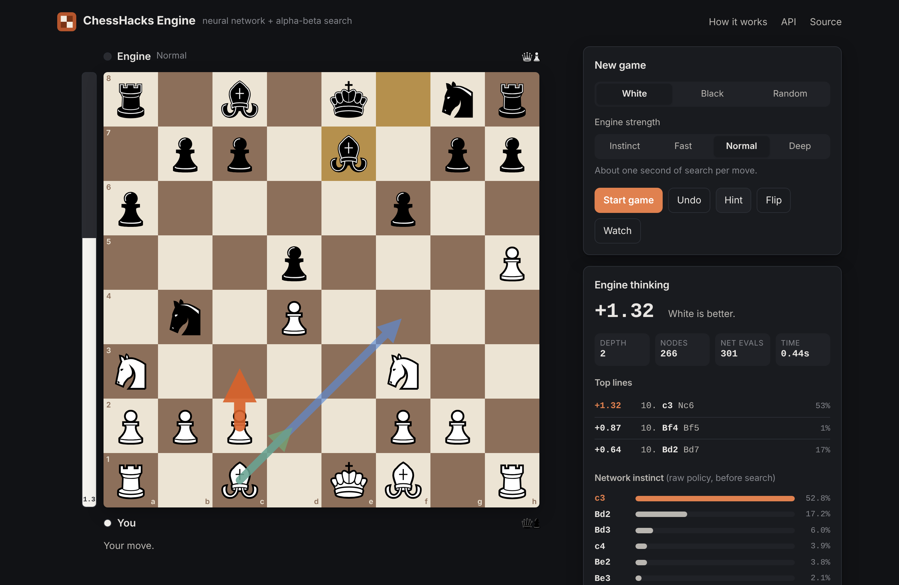

# ChessHacks Engine

A chess engine built around a neural network trained on Stockfish-labelled positions, with a browser app for playing against it and watching how it decides on a move.



## Background

This started at the ChessHacks hackathon in November 2025, where I built it with Ethan Fung. The challenge was to write a chess bot whose decisions come from a neural network rather than a hand-written evaluation function. We trained a residual network on positions labelled by Stockfish, put a small search on top of it, and submitted it.

It worked, but only just. Coming back to it afterwards, I found a few problems in the final hackathon commit that are easy to miss when you are racing a deadline:

- The checkpoint it loaded was the large 256-channel network with attention blocks, but the model class it imported was the small 128-channel one. The weights could not load, and the bot quietly fell back to playing random legal moves.
- The checkpoint path was hard-coded to a folder on one of our Windows machines, so it would not have loaded anywhere else either.
- The search had a 0.18 second budget and tried to go eight plies deep on its first candidate. It ran out of time almost immediately, so in practice it played whatever the policy head liked best.

So I rebuilt the engine around the networks we had trained: a proper search, a web app to play against it, tests, and a benchmark against Stockfish to see how strong it actually is.

## What the app does

- Play as White or Black against four strength levels. "Instinct" plays the network's first choice with no search at all. "Fast", "Normal" and "Deep" search for about 0.3, 1 and 3 seconds per move.
- See what the engine is thinking. After every move the side panel shows the evaluation, the search depth, how many positions were visited, the top three lines, and the network's raw move probabilities next to the move the search actually chose. Watching the search overrule the network's first instinct is the most interesting part.
- Ask for a hint, which draws the three best candidate moves on the board.
- Let the engine play itself.
- Use the engine through a small JSON API. Interactive documentation is served at `/api/docs`.

The board is written from scratch in plain JavaScript, with no framework and no build step. It supports drag and drop or click-to-move, animates moves (castling and en passant included) and works on phones. All of the chess rules live on the server in python-chess, so the browser only ever offers moves the server has already said are legal.

## How the engine works

### Training data

About 1.38 million positions, each labelled by Stockfish with an evaluation, a best move, the change in evaluation after that move, and the eventual result of the game:

- 182,000 positions from master games (a slice of the Lumbras Gigabase from 2015 to 2019, plus recent games by Ding Liren and Gukesh), analysed at depth 14.
- 1.2 million positions from games where the moves were chosen at random but every position was labelled by Stockfish at depth 12. Master games are full of balanced, well-understood positions. Random games force the network to judge lopsided and messy ones too.

The labelled data is in `processed/` as NumPy archives.

### The network

The board goes in as 18 planes of 8 by 8: one for each piece type and colour, plus side to move, the four castling rights and the en passant file. A residual convolutional network turns that into four outputs:

| Head | What it predicts |
| --- | --- |
| Policy | A probability for each of the 20,480 from-square, to-square and promotion combinations, trained to match Stockfish's best move |
| Value | The evaluation in centipawns, from the side to move |
| Delta | How much the evaluation changes if the best move is played |
| Result | The expected game result, from -1 to 1 |

Two sizes were trained:

| | Small (used by the app) | Large |
| --- | --- | --- |
| Residual blocks | 6 | 9, each with CBAM channel and spatial attention |
| Channels | 128 | 256 |
| Parameters | 7.2M | 16.1M |
| One position on a 4-core CPU | about 1.6 ms | about 12 ms |

The small network was then fine-tuned with self-play (below). Given the same thinking time it beats the large one, largely because it is about seven times faster and so searches deeper. The loader inspects a checkpoint's parameter shapes to work out which architecture and size it is, so switching networks is just a matter of setting `CHESS_ENGINE_CHECKPOINT`.

### Self-play fine-tuning

The engine plays games against itself. At every move Stockfish scores the engine's five favourite candidates, and the best of those becomes the training target for that position. A quarter of the time the engine deliberately plays one of the weaker candidates, so it also sees positions where someone has just blundered. Only games that end in checkmate are kept. The loop lives in `selfPlay/`.

### The search

The network on its own is a decent judge of a position but a poor calculator, so `src/search.py` adds a search on top:

- Negamax with alpha-beta pruning, inside iterative deepening, so there is always a finished answer when time runs out.
- Moves are ordered by the policy head, so cutoffs happen early. A transposition table remembers the best move from earlier iterations and tries it first.
- Away from the root, only the network's most likely moves are searched (the top eight, or enough to cover 95 percent of the probability), plus every capture, check and promotion. This is what lets a Python search see a few moves ahead at all.
- Leaf positions are sent to the network in batches of up to 16. On a CPU a batch of 16 costs only a few times as much as a single position.
- A quiescence search plays out captures at the leaves before trusting the evaluation, so the engine does not stop calculating in the middle of an exchange.
- The evaluation at the leaves is the network's opinion plus a plain material count. Why that matters is explained in the next section.
- Iterative deepening keeps whatever an unfinished iteration managed to prove. The previous best move is always searched first, so if another move finishes with a better score it really is better at the new depth. This lets the engine use most of its thinking time instead of stopping early to avoid wasted work.
- MultiPV at the root, so the app can show the top three lines with exact scores.
- Mates are scored by distance, so the engine goes for the fastest one, and repeated positions count as draws.

## How strong is it?

Strength is measured with `scripts/benchmark.py`, which plays the engine against Stockfish 16 with its strength limited through `UCI_LimitStrength`. The engine gets one second per move and Stockfish a tenth of a second (the limit that matters for Stockfish is its Elo setting, not its time). Games start from ten balanced openings and colours alternate, so each opening is played from both sides.

| Version | Games | Result vs Stockfish at UCI_Elo 1320 | Score |
| --- | --- | --- | --- |
| Search with network-only evaluation | 12 | 0 wins, 2 draws, 10 losses | 8% |
| Network plus material evaluation (current) | 20 | 7 wins, 2 draws, 11 losses | 40% |

A 40% score against the 1320 setting works out to roughly 1250 on Stockfish's scale, give or take 150 with this few games. That scale is calibrated against other engines at fast time controls rather than against human ratings, so it is a reference point and not a human Elo. In practice it plays sensible openings and punishes loose pieces, but it still drifts in long endgames where there is no tactic to find.

The first benchmark was humbling, and finding out why was the most useful part of the project. Going through the losses with Stockfish showed the same pattern over and over: the engine hung pieces to short tactics. In one game it played 12...Bg5 to attack White's queen on d2. The reply 13.Qxg5 wins a piece, because once the queen leaves d2 the bishop on c1 defends g5, so 13...Qxg5 14.Bxg5 leaves Black a bishop down. The search did look at 13.Qxg5. The trouble was that the network evaluated the position after it as good for Black, and the quiescence search trusted that evaluation instead of playing the exchange out.

To check whether that was a one-off, I fit the network's evaluation against Stockfish's on about 14,000 labelled positions. The network on its own explains 68% of the variance and a plain material count explains 67%, but the two together explain 78%. They make different mistakes. Using the network's value plus material as the evaluation, together with a change that lets the search use more of its thinking time, mostly fixed the hung-piece pattern and took the score from 8% to 40%. That is something like 300 Elo, although with this few games the error bars on both numbers are wide.

A few other things the measurements showed:

- The small network beats the large one at equal thinking time (5 wins, 4 draws and no losses in a 9-game match at half a second per move). Being seven times faster is worth more than the extra capacity when the search is this shallow.
- Adding quiescence search on its own was a wash (6 to 6 over 12 games against the version without it). It only paid off once the evaluation it relies on could be trusted.

To reproduce or extend these numbers:

```bash
python scripts/benchmark.py --elo 1320 1500 --games 20 --think 1.0 --pgn games.pgn
```

## Running it

You need Python 3.10 or newer.

```bash
git clone https://github.com/ZhuG07/ChessHacks.git
cd ChessHacks
python -m venv .venv
source .venv/bin/activate
pip install -r requirements.txt
python scripts/fetch_weights.py   # only needed if you cloned without Git LFS
uvicorn app.server:app --port 8000
```

Then open http://localhost:8000.

The model checkpoints are stored with Git LFS. If you cloned without it, the `.pt` files are small text pointers. `scripts/fetch_weights.py` downloads the real files and checks them against the SHA-256 in the pointer.

Useful environment variables:

| Variable | Default | Meaning |
| --- | --- | --- |
| `CHESS_ENGINE_CHECKPOINT` | `best_selfplay.pt` | Checkpoint to load, either a file in `src/model_save/` or a full path |
| `TORCH_THREADS` | PyTorch default | CPU threads used for inference |
| `MAX_THINK_SECONDS` | `5` | Upper limit on thinking time per request |

### Docker

```bash
docker build -t chesshacks-engine .
docker run -p 8000:8000 chesshacks-engine
```

The image uses CPU-only PyTorch and downloads the weights during the build if needed. Any host that runs a container will work (Render, Fly.io, Railway, Hugging Face Spaces and so on). Two CPU cores and 1 GB of memory are enough.

### Tests

```bash
pip install -r requirements-dev.txt
pytest
```

The tests cover the board encoding, both network architectures and the checkpoint loader, the search (it has to find mates and win hanging pieces), and every API endpoint. They also run on GitHub Actions for every push.

### API

```bash
curl -s localhost:8000/api/move \
  -H 'Content-Type: application/json' \
  -d '{"moves": ["e2e4", "e7e5", "g1f3"], "think_time": 1.0}'
```

The server is stateless. Each request carries the moves played so far (and optionally a starting FEN), and the response includes the engine's move, its analysis and the new position with its legal moves.

## Project layout

```
app/
  server.py          FastAPI server: JSON API and the static site
  static/            the browser app (HTML, CSS, plain JavaScript, piece SVGs)
src/
  encoding.py        board to 18x8x8 tensor, move to policy index
  model.py           both network architectures and the checkpoint loader
  search.py          alpha-beta, quiescence, transposition table, MultiPV
  engine.py          loads a checkpoint and exposes analyse() and best_move()
  main.py            entry point for the ChessHacks tournament platform
  train.py           supervised training
  data_gen.py        random-move games labelled by Stockfish
  model_save/        trained checkpoints (Git LFS)
selfPlay/            self-play fine-tuning loop
dataset_creation.py  labels master games from a PGN file with Stockfish
processed/           labelled training data
scripts/
  fetch_weights.py   downloads the checkpoints if the clone only has LFS pointers
  benchmark.py       plays the engine against Stockfish
serve.py             backend for the ChessHacks dev tools
tests/               pytest suite
```

## Training it yourself

The training scripts need Stockfish. They look for it in `$STOCKFISH_PATH`, then on your `PATH`.

```bash
pip install -r requirements-dev.txt

# Label master games from a PGN file (set PGN_PATH, or put the file in data/)
python dataset_creation.py

# Generate random-move games labelled by Stockfish
python src/data_gen.py

# Supervised training on everything in processed/
python src/train.py

# Self-play fine-tuning
python -m selfPlay.loop --cycles 1
```

A GPU helps a lot for training. Inference and the app run fine on a CPU.

## What I would do next

- The search is plain Python and visits a few hundred positions per second, which is why it only sees two to four moves ahead plus captures. Moving the search to C++ or Rust, or running the network through ONNX Runtime, would buy several more plies.
- The value head is badly calibrated on its own. It knows being a queen up is good but rates it at about +1.4 pawns rather than +9, which is part of why the material term helps so much. Retraining it, ideally with positions where pieces are hanging, would be better than patching around it.
- With a reasonable policy head, Monte Carlo tree search in the style of AlphaZero is the obvious alternative to alpha-beta and would be interesting to compare.
- Random-move games are cheap to generate but unlike real chess. More self-play data would probably help more than more random data.

## Acknowledgements

- Ethan Fung, my teammate at ChessHacks, who built the first version of the model and the self-play loop.
- The ChessHacks organisers for the starter kit (`serve.py` and `src/utils/`).
- [Stockfish](https://stockfishchess.org/) for the training labels and for being the benchmark opponent, and [python-chess](https://python-chess.readthedocs.io/) for the rules.
- The Chessnut piece set by Alexis Luengas, used under the Apache 2.0 license (see `app/static/pieces/LICENSE.txt`).
